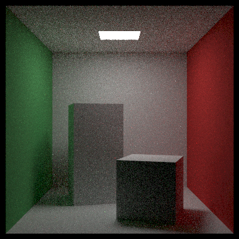
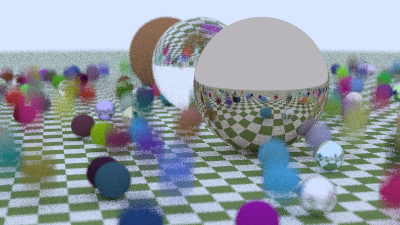

# Nearlighter

Nearlighter 是一个用于学习与实验的 CPU 路径追踪渲染器，基础框架参考 [Ray Tracing in One Weekend 系列](https://github.com/RayTracing/raytracing.github.io)。项目支持通过 JSON 加载场景，也可以作为 C++ 库使用。

## 功能特性

- 路径追踪与 BVH 加速，支持散射采样、混合采样、光源采样和 MIS
- 球体、四边形、三角形与网格，支持对象组合及实例变换
- 漫反射、GGX 金属、理想电介质、自发光表面与均匀介质
- 区域光源、常量环境光，以及各向同性介质散射
- 纯色、棋盘格、图像与 Perlin 噪声纹理
- 多样本抗锯齿、景深与运动模糊
- PPM 图像与线性 PFM 输出，支持分层输出（AOV）、采样方差和渲染统计

## 依赖与构建

### 环境需求

- CMake 3.20 或更高版本
- 支持 C++17 的编译器
- Git，用于获取第三方依赖
- GNU Make，供内置 CMake preset 使用

评估脚本额外需要 Python 3。克隆项目后，在项目根目录初始化依赖：

```bash
git submodule update --init --recursive
```

### 构建方式

以下命令均从项目根目录执行。Release 用于正常渲染和性能评估，输出位于 `build/release/`：

```bash
cmake --preset release
cmake --build --preset release
```

Debug 用于开发和错误检查，输出位于 `build/debug/`：

```bash
cmake --preset debug
cmake --build --preset debug
```

如需其他构建工具，可通过 `CMakeUserPresets.json` 定义本地 preset。VS Code 配置见 [CMake Preset 使用说明](docs/vscode-cmake.md)。

## 使用方式

### 命令行渲染

默认渲染 Cornell Box，在终端显示进度，并输出到当前目录的 `out.ppm`：

```bash
./build/release/Nearlighter
```

使用内置场景名称，或指定场景 JSON 路径：

```bash
./build/release/Nearlighter --scene earth
./build/release/Nearlighter --scene experiments/test.json
```

内置名称可省略 `.json`；包含目录的相对路径以当前工作目录为基准，也支持绝对路径。内置场景包括：

```text
bouncing_spheres   checker_spheres  earth          perlin_sphere
quads              simple_light     cornell_box_rtow
cornell_smoke      final_scene      cornell_ball    cornell_bunny
```

覆盖分辨率、每像素样本数和输出路径；需要线性图像时增加 `--linear-output`：

```bash
./build/release/Nearlighter --scene cornell_box_rtow \
    --width 400 --height 400 --spp 64 --max-depth 25 \
    --output out.ppm --linear-output out.pfm
./build/release/Nearlighter --help
```

通过 `--sampling` 选择采样策略：

| 参数 | 策略 | 支持场景 |
|---|---|---|
| `scattering` | 按材质散射分布采样 | 表面与介质 |
| `mixture`（默认） | 混合散射采样与场景配置的目标采样 | 表面与介质 |
| `light` | 光源采样 | 纯表面 |
| `mis` | 多重重要性采样 | 纯表面 |

`mixture` 未配置采样目标时使用散射采样。含介质场景请选择 `scattering` 或 `mixture`；当前不支持介质中的光源采样及 MIS。

### C++ 库接入

在调用方的 CMake 中添加源码目录并链接 SDK：

```cmake
add_subdirectory(path/to/Nearlighter nearlighter)
add_executable(my_app main.cpp)
target_link_libraries(my_app PRIVATE Nearlighter::Nearlighter)
```

对应的 C++ 入口：

```cpp
#include <nearlighter/nearlighter.h>
```

仅需场景构造与渲染时，可链接 `nearlighter_core` 并包含 `<nearlighter/core.h>`。需要场景、图像等 I/O 时，可链接 `nearlighter_io` 并包含 `<nearlighter/io.h>`。

## 测试评估

### 单元测试

构建完成后，通过对应 preset 运行测试：

```bash
ctest --preset debug
ctest --preset release
```

测试覆盖说明见 [tests/README.md](tests/README.md)。

### 集成评估

评估脚本默认构建 Release、运行测试，再渲染固定场景并与参考图像比较，生成误差与性能报告。

首次运行前，请按 [完整验证指南](scripts/README.md#首次完整验证) 准备参考图像。`prepare_benchmark.py` 只准备 benchmark；quick 和 full 的参考图像需要分别通过 `generate_reference.py` 生成。

```bash
python3 scripts/evaluate.py --suite quick
python3 scripts/evaluate.py --suite full
python3 scripts/evaluate.py --suite benchmark
```

`quick` 用于日常快速检查，`full` 用于较高分辨率检查，`benchmark` 包含官方 Cornell 参考图像与 Stanford Bunny 网格场景。

参考图像位于 `benchmark/references/`，每次评估的图像、日志和报告写入 `build/evaluation/runs/`。详细选项见 [脚本说明](scripts/README.md)，数据来源与适配限制见 [Benchmark 说明](benchmark/README.md)。

## 渲染示例

Cornell Box



运动球体



## 项目结构

```
.
├── include/nearlighter/  # 项目公开头文件，按功能模块组织
├── src/                  # 库实现与命令行入口
├── thirdparty/           # 第三方库 submodule
├── assets/               # 运行时场景、纹理与模型资源
├── benchmark/            # 测评数据与固定 reference
├── cmake/                # 项目 CMake 辅助模块
├── scripts/              # 构建、reference 生成与集成评估脚本
├── tests/                # 确定性 C++ 测试
└── docs/                 # 实现笔记与渲染结果
```

## 项目文档

- [脚本与 evaluation 说明](scripts/README.md)
- [Benchmark 数据与场景说明](benchmark/README.md)
- [单元测试说明](tests/README.md)
- [VS Code CMake Preset 配置](docs/vscode-cmake.md)
- [命中、材质、介质与渲染流程](docs/hit-material-medium.md)
- [材质与采样接口](docs/material-sampling.md)
- [渲染实现笔记](docs/note.md)
- [几何求交笔记](docs/hit-calculation.md)

## 参考资料

- [Ray Tracing in One Weekend 系列](https://github.com/RayTracing/raytracing.github.io)
- [GAMES101 课程](https://games-cn.org/intro-graphics/)
- [STB 图像库](https://github.com/nothings/stb)
- [argparse](https://github.com/p-ranav/argparse)
- [JSON for Modern C++](https://github.com/nlohmann/json)
